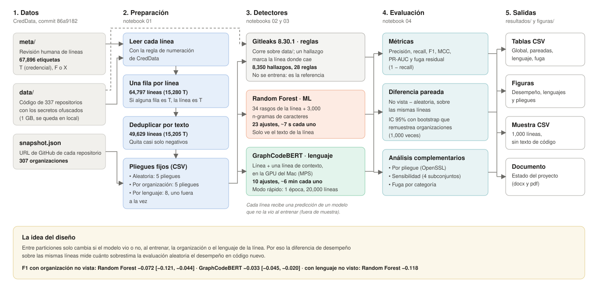

# NewCodeCreds

**Desempeño de detectores de credenciales en repositorios y tipos de archivo no vistos**

El nombre resume lo que se mide: qué tan bien detectan credenciales (*creds*) los detectores cuando
el código es nuevo para ellos (*new code*), es decir, viene de repositorios o lenguajes que no
estaban en su entrenamiento.

Edward Alexander Gómez Ispanel, Jocelyn Abigail De León Ardón y Brazil Abraham Batres Cruz

Maestría en Data Science · Curso Investigación en Data Science · Noviembre 2026

## Pregunta de investigación

En código de repositorios públicos, ¿cómo cambia el desempeño de detectores de credenciales
(reglas, aprendizaje automático y modelos de lenguaje) cuando se evalúan en repositorios o tipos
de archivo no vistos frente a particiones aleatorias?

- **H₁a:** el desempeño (F1 o MCC) es menor en particiones por repositorio, agrupadas por
  organización, que en particiones aleatorias deduplicadas.
- **H₁b:** el desempeño es menor en particiones por tipo de archivo que en particiones aleatorias
  deduplicadas.

Detectores: Gitleaks 8.30.1 (reglas), Random Forest (aprendizaje automático) y GraphCodeBERT
(modelo de lenguaje). Datos: [CredData](https://github.com/Samsung/CredData) de Samsung, commit
`86a9182`.

## Cómo funciona el pipeline



1. **Datos.** CredData trae las etiquetas (`meta/`), el código con los secretos ofuscados
   (`data/`) y la URL de cada repositorio (`snapshot.json`), de donde sale la organización.
2. **Preparación (notebook 01).** Cada línea candidata se lee con la regla de numeración de
   CredData, se deja una fila por línea y se deduplica por texto. Después se asigna cada línea a
   los pliegues de tres particiones: aleatoria, por organización y por lenguaje. Los pliegues se
   guardan en archivos para que todos los detectores usen los mismos.
3. **Detectores (notebooks 02 y 03).** Gitleaks no se entrena y sirve de referencia. Random
   Forest y GraphCodeBERT se entrenan una vez por pliegue, así que cada línea recibe una
   predicción de un modelo que no la vio.
4. **Evaluación (notebook 04).** Para cada detector se compara su desempeño con una partición no
   vista frente a la aleatoria, sobre las mismas líneas. El intervalo de confianza sale de un
   bootstrap que remuestrea organizaciones completas.
5. **Salidas.** Tablas, figuras, la muestra del dataset y el documento de la actividad.

La imagen también está en PNG (`figuras/pipeline.png`, 2720 × 1320) para usarla en
presentaciones.

## Resultados preliminares (Actividad 05)

| Detector | Partición aleatoria (F1) | Organización no vista (F1) | Diferencia [IC 95%] |
|---|---|---|---|
| Gitleaks (reglas) | 0.604 | 0.604 | no se entrena |
| Random Forest | 0.943 | 0.871 | −0.072 [−0.121, −0.044] |
| GraphCodeBERT (modo rápido) | 0.958 | 0.925 | −0.033 [−0.045, −0.020] |

Con lenguajes no vistos, el F1 de Random Forest baja 0.118 [−0.160, −0.086]. El detalle está en
`Actividad 05 - (Estado actual del proyecto).pdf` y en el notebook 04.

## Contenido del repositorio

```
NewCodeCreds/
├── notebooks/
│   ├── 01_preparacion_y_particiones.ipynb   tabla de análisis, deduplicación y pliegues
│   ├── 02_gitleaks_y_random_forest.ipynb    predicciones de Gitleaks y Random Forest
│   ├── 03_graphcodebert_mps.ipynb           ajuste de GraphCodeBERT en la GPU del Mac
│   ├── 04_evaluacion_resultados.ipynb       métricas, diferencias pareadas, figuras y muestra
│   └── ids_utils.py                         funciones que importan los cuatro notebooks
├── datos_procesados/                        predicciones y rasgos (sin texto de código)
├── resultados/                              tablas CSV, asignación de pliegues y muestra del dataset
├── figuras/                                 figuras del documento
├── Actividad 05 - (Estado actual del proyecto).docx / .pdf
└── requirements.txt
```

Los notebooks ya tienen sus salidas guardadas: **para ver los resultados basta con abrirlos en
GitHub o en VS Code**, sin ejecutar nada.

**Muestra del dataset:**
[`resultados/credata_muestra_actividad05.csv`](resultados/credata_muestra_actividad05.csv). Son
1,000 líneas del conjunto deduplicado (100 T y 100 no T por pliegue de la partición por
organización), con metadatos, variables derivadas, pliegues, rasgos y predicciones de los tres
detectores. No incluye el texto de las líneas de código.

**Lo que no está en el repositorio** (cada uno lo genera en su computadora):

| Archivo | Por qué no se sube | Lo genera |
|---|---|---|
| `../CredData/` | 1 GB de código de terceros, cada archivo con su licencia | Paso 3 |
| `datos_procesados/lineas.parquet` | Contiene el texto de las líneas de código | Notebook 01 |
| `datos_procesados/gitleaks_hallazgos.json` | Contiene fragmentos de código | Paso 4 |
| `herramientas/` | Binario de Gitleaks | Paso 4 |

## Cómo ejecutar el proyecto desde cero

Probado en un Mac con Apple Silicon (M5 Pro). En Linux o Windows funcionan los notebooks 01, 02 y
04; el 03 necesita una GPU (ver paso 6).

### 1. Clonar el repositorio

Las rutas de los notebooks esperan que **CredData quede al lado del repositorio**, en la misma
carpeta padre. Conviene crear una carpeta de trabajo:

```bash
mkdir investigacion && cd investigacion
git clone https://github.com/edward25nov/NewCodeCreds.git
```

Al final del paso 3 la estructura debe quedar así:

```
investigacion/
├── NewCodeCreds/     este repositorio
└── CredData/         el dataset (paso 3)
```

### 2. Crear el ambiente de Python

Con conda ([Miniforge](https://github.com/conda-forge/miniforge)):

```bash
conda create -n newcodecreds python=3.12 pip -y
conda activate newcodecreds
pip install -r NewCodeCreds/requirements.txt
python -m ipykernel install --user --name newcodecreds --display-name "Python (newcodecreds)"
```

Para comprobar que quedó bien:

```bash
python -c "import sklearn, torch; print('ok', torch.backends.mps.is_available())"
```

Debe imprimir `ok True` en un Mac con Apple Silicon (`ok False` en otros equipos: los notebooks
01, 02 y 04 no usan la GPU).

> **Si aparece `OMP: Error #15: Initializing libomp.dylib, but found libomp.dylib already
> initialized`.** Pasa en Mac cuando `torch` se instaló con pip y `scikit-learn` con conda: cada
> uno trae su copia de OpenMP. Arreglo (reemplaza la copia de `torch` por la del ambiente y
> deja respaldo):
>
> ```bash
> L=$(python -c "import os, sklearn; print(os.path.dirname(sklearn.__file__))")/../torch/lib
> mv "$L/libomp.dylib" "$L/libomp.dylib.bak" && ln -s "$CONDA_PREFIX/lib/libomp.dylib" "$L/libomp.dylib"
> ```
>
> No uses `KMP_DUPLICATE_LIB_OK=TRUE`: oculta el error pero puede dar resultados incorrectos.

### 3. Descargar CredData

CredData no trae el código: trae las etiquetas y un script que descarga los archivos de cada
repositorio y oculta los secretos. **Hay que usar el commit `86a9182`**, porque otra versión
tiene otras etiquetas y los números no coincidirían.

```bash
cd investigacion            # la carpeta padre, no NewCodeCreds
git clone https://github.com/Samsung/CredData.git
cd CredData
git checkout 86a9182
python -m pip install -r requirements.txt
python download_data.py --data_dir data
```

- La descarga tarda bastante (son 337 repositorios) y ocupa cerca de 1 GB en `CredData/data`.
- **CredData recomienda Linux y Python 3.10** para descargar: algunos nombres de archivo no son
  válidos en Windows. Nosotros lo descargamos en una máquina virtual Linux y copiamos la carpeta
  `CredData` completa al Mac.
- **Alternativa más rápida dentro del grupo:** pedirle a Edward el `CredData.zip` ya descargado
  (unos 210 MB) y descomprimirlo en `investigacion/`. Es solo para uso del grupo: no lo subas a
  ningún repositorio.

Para comprobar: `ls CredData/meta | wc -l` debe dar 337 y `CredData/snapshot.json` debe existir.

### 4. Ejecutar Gitleaks 8.30.1

Descarga el binario de tu sistema desde
[la versión 8.30.1 de Gitleaks](https://github.com/gitleaks/gitleaks/releases/tag/v8.30.1)
(en Mac con Apple Silicon: `gitleaks_8.30.1_darwin_arm64.tar.gz`) y descomprímelo en
`NewCodeCreds/herramientas/`. Después, desde la carpeta `NewCodeCreds`:

```bash
cd investigacion/NewCodeCreds
./herramientas/gitleaks dir ../CredData/data -f json -r datos_procesados/gitleaks_hallazgos.json --exit-code 0
```

Debe reportar 8,350 hallazgos. Usa esa versión exacta, porque otra versión trae otras reglas.
En Mac, si el sistema bloquea el binario por no estar firmado, ejecuta
`xattr -d com.apple.quarantine herramientas/gitleaks`.

### 5. Ejecutar los notebooks en VS Code

Abre la carpeta `NewCodeCreds` en VS Code (con las extensiones de Python y Jupyter), abre cada
notebook, elige el kernel **Python (newcodecreds)** y usa **Run All**, en este orden:

| Notebook | Qué hace | Tiempo aprox. (Mac M5 Pro) | Qué debes ver |
|---|---|---|---|
| 01 | Tabla de análisis y pliegues | 10 s | `Conjunto deduplicado: 49629 líneas, 15205 T (30.6%)` |
| 02 | Gitleaks y Random Forest (23 ajustes) | 3 min | Tabla cruzada con 7,005 T detectadas por Gitleaks |
| 03 | GraphCodeBERT (opcional, ver paso 6) | 1 h | Un tiempo por pliegue, como `aleatorio 0 342 s` |
| 04 | Métricas, figuras y muestra | 1 min | Las tablas y figuras del documento |

- Cada notebook usa los archivos que deja el anterior, así que el orden importa.
- Los notebooks esperan correr con la carpeta `notebooks/` como directorio de trabajo, que es lo
  que hace VS Code al abrirlos.
- Los pliegues no se recalculan: el notebook 01 los lee de `resultados/asignacion_pliegues_*.csv`.
  Así todos obtenemos la misma partición aunque tengamos otra versión de scikit-learn.
- Random Forest puede cambiar alrededor del 1.5% de sus predicciones entre computadoras. Las
  métricas globales coinciden hasta el tercer decimal, pero las cifras por categoría de
  credencial pueden variar.

### 6. GraphCodeBERT (opcional)

**No hace falta correr el notebook 03 para reproducir los resultados.** Sus predicciones ya están
en `datos_procesados/predicciones_graphcodebert.parquet`, y el notebook 04 las incorpora solo.

Si lo vas a correr, necesitas una GPU: MPS en un Mac con Apple Silicon o CUDA en otra máquina. En
CPU tarda horas por pliegue. La primera vez descarga el modelo `microsoft/graphcodebert-base`
(unos 500 MB). `MODO = "rapido"` hace 10 ajustes de unos 6 minutos cada uno. `MODO = "completo"`
(2 épocas, los ocho lenguajes y 256 tokens) toma unas 15 horas. **Correrlo sobrescribe el
parquet anterior**, así que conviene hacerlo en una rama.

## Para trabajar en grupo

La rama `main` está protegida: **no se puede hacer push directo a `main`** ni forzar un push, y
la rama no se puede borrar. Todo cambio entra por un pull request (PR). No hace falta que otra
persona lo apruebe: cada uno puede unir su propio PR.

### Flujo para cada cambio

1. Actualiza `main` y crea una rama con un nombre que diga qué vas a hacer:

   ```bash
   git switch main
   git pull
   git switch -c actividad-06
   ```

2. Haz tus cambios y tus commits en esa rama. Usamos
   [Conventional Commits](https://www.conventionalcommits.org/es/) en español, por ejemplo
   `feat(notebooks): agregar umbral con costo asimétrico`.
3. Sube la rama y abre el PR, desde la terminal con [GitHub CLI](https://cli.github.com/) o
   desde la página del repositorio:

   ```bash
   git push -u origin actividad-06
   gh pr create --fill
   ```

4. Revisa en el PR que los cambios sean los esperados y únelo con **Squash and merge**
   (`gh pr merge --squash --delete-branch`).
5. Vuelve a `main` y actualízala: `git switch main && git pull`.

Si `git push` responde que `main` está protegida, hiciste commit en `main` por error. Lleva esos
commits a una rama nueva y deja `main` igual que en GitHub:

```bash
git switch -c mi-rama                         # la rama nueva conserva tus commits
git switch main && git reset --hard origin/main
git switch mi-rama && git push -u origin mi-rama
```

### Acuerdos

- Si vas a modificar un notebook, avisa en el grupo. Dos personas que editan el mismo `.ipynb` a
  la vez generan conflictos difíciles de resolver.
- Antes de hacer commit de un notebook, revisa que ninguna salida muestre texto de líneas de
  CredData (por ejemplo, `lineas.texto.head()`): el proyecto se comprometió a no reproducir
  código de terceros.
- Semilla: 42 en todo el proyecto (`ids_utils.SEMILLA`).
